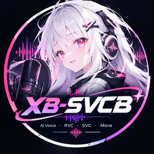
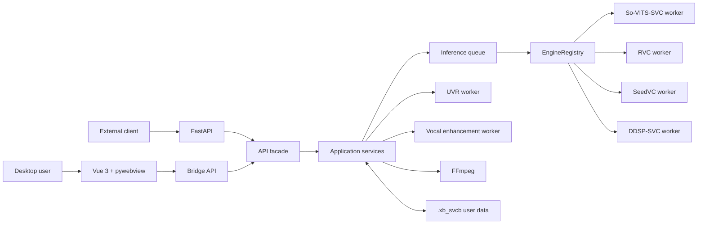

<div align="center">

[简体中文](README.md) | **English** | [日本語](README.ja.md)



# XB-SVCB · AI Song Cover Studio

#### A ready-to-use desktop workstation for AI song covers

**Import · Vocal separation · Dereverb · Voice conversion · Vocal enhancement · Mixing · Export**

Create a complete AI song cover in one workflow. Supports **So-VITS-SVC and RVC inference**, **multi-singer covers**, **real-time system-audio conversion**, **AI vocal enhancement projects**, an **online music library**, a **model hub**, and an **audio editor**.

[](LICENSE)
[](https://github.com/SDIJF1521/xb-svcb/releases/latest)
[](https://github.com/SDIJF1521/xb-svcb/releases)
[](https://github.com/SDIJF1521/xb-svcb/stargazers)

[](#)
[](#)
[](#)
[](#architecture)

### [Download the installer for your hardware: CPU / ROCm 10 / DirectML / CUDA126 / CUDA128](https://github.com/SDIJF1521/xb-svcb/releases/latest)

<sub>One-click Windows installation with the frontend and base models included. No manual Python or Node.js setup required.</sub>

<sub>Community and support (QQ group): **1038366109**</sub>

<sub>Website: **[https://xb-svcb.cn](https://xb-svcb.cn)** · Documentation: **[English](docs/en/README.md)**</sub>
</div>

---

## Overview

XB-SVCB is a local-first Windows application for AI song covers and audio production. Its interface is built with Vue 3, its application core is written in Python, and each AI framework runs in an isolated environment and worker process.

The project supports So-VITS-SVC, RVC, SeedVC, and DDSP-SVC. It also provides UVR / PyMSS vocal separation, AI vocal enhancement, high-note protection, an online music library, a model hub, real-time system-audio conversion, and the Audio Editor Lite multitrack editor.

## Features

- Run vocal separation, dereverb, F0 analysis, voice conversion, enhancement, and mixing as one workflow.
- Manage So-VITS-SVC, RVC, SeedVC, and DDSP-SVC models through one interface with framework-specific parameters.
- Protect notes outside a model's range by retrying affected regions at a lower pitch and restoring the original pitch afterward.
- Split songs from lyrics or silence detection, assign models on a visual timeline, and create multi-singer or ensemble covers.
- Edit tracks, cut and fade clips, route channels, apply effects, and export WAV / MP3 / FLAC with Audio Editor Lite.
- Import TXT / LRC lyrics and use role-based solo, duet, and harmony timeline templates.
- Convert player audio in real time through WASAPI loopback or VB-CABLE while preserving the accompaniment.
- Search, upload, and download models through ModelScope with background transfers, resume support, and manifest verification.
- Search, preview, and download songs and lyrics from NetEase Cloud Music, QQ Music, and Kuwo Music.
- Select NVIDIA CUDA, Windows AMD ROCm 10, DirectML, or CPU execution.
- Enable an optional FastAPI service for task creation, progress tracking, model management, and result downloads.
- Extend the application with custom pages, Python plugin workers, and a C++ JUCE VST3 host.

## Quick Start

### Installer

For normal use, install the latest release from GitHub:

1. Choose the CPU, ROCm 10, DirectML, CUDA126, or CUDA128 package for your hardware. Download its EXE and every BIN file sharing the same filename prefix.
2. Run the EXE and select both the application directory and user-data directory.
3. Select a 64-bit CPython 3.12.x installation, or let the installer detect one, then keep **Set up the runtime after installation** enabled.
4. Start XB-SVCB from the desktop or Start menu.

The package contains the built frontend, FFmpeg, engine source code, essential base models, and offline Python dependencies for the selected hardware stack. Use CUDA126 for NVIDIA RTX 40-series and older GPUs, CUDA128 for RTX 50-series GPUs, ROCm 10 as the preferred Windows AMD backend, DirectML as an alternative AMD backend, and CPU when no compatible GPU is available. DirectML does not accelerate PyMSS, and DDSP automatic mode uses the CPU.

### Install from source

Source builds require Windows, 64-bit CPython 3.12.x, and Node.js 20.19+ or 22.12+. Run one hardware-specific setup command from the repository root:

```bat
setup_env.bat --cu128
setup_env.bat --cu126
setup_env.bat --rocm10
setup_env.bat --directml
setup_env.bat --cpu
```

CUDA126 and CUDA128 use shared `runtimes/core-*` and `runtimes/svc-*` environments. ROCm 10 shares its SVC, RVC, and vocal-enhancement runtime; CPU and DirectML use isolated environments. See the [English installation guide](docs/en/getting-started.md) for the complete layout and troubleshooting steps.

Useful component-only setup commands:

```bat
setup_env.bat --only uvr seedvc ddsp
setup_env.bat --only svc rvc vocal
setup_env.bat --only models
```

UVR, SeedVC, and DDSP form an atomic CUDA core group and should be repaired together.

### Start the application

Production mode loads the prebuilt `web/dist` frontend:

```bat
run.bat
```

For frontend development, start Vite in one terminal:

```bat
cd web
npm install
npm run dev
```

Then start the Python backend in another terminal:

```bat
app\.venv\Scripts\python.exe app\main.py --dev
```

Development mode connects to `http://localhost:5173` by default. Set `XB_DEV_URL` to use another frontend URL.

## Basic Workflow

1. Import or download a voice model in **Model Management**.
2. Select a song, vocal-separation method, target model, and device on the creation page.
3. Submit a single-model task directly, or import lyrics / detect silence to create a timeline for a multi-model cover.
4. Adjust segment boundaries and assign one or more models to each segment.
5. Wait for inference, enhancement, and mixing, then preview or export the result from the library.
6. Send the result to Audio Editor Lite for regional re-inference, effects, or multitrack editing when needed.

Real-time system-audio mode supports one RVC or SeedVC model. It captures mixed player output, extracts the vocal with UVR, converts it, and mixes it back with the original accompaniment.

## Architecture

The desktop UI and FastAPI interface share the same Python application core. Heavy models and audio tools execute in isolated worker processes.



The main process owns the desktop shell, API, and application orchestration. It does not load every model into one Python process. `runtime.json` maps each component to its actual interpreter.

## FastAPI Integration

FastAPI is disabled by default. Open **Library → API Access** in the application, configure its bind address, port, and API key, and start the service manually.

The API supports model management, single-model and multi-model inference, batch jobs, streamed uploads, progress and history queries, presets, result downloads, and Audio Editor Lite project operations. The desktop UI and HTTP clients use the same application services and task queue. See the [English API guide](docs/en/api.md) for the endpoint reference.

## Plugin System

Plugins are managed by `PluginService`. Plugin pages run in restricted iframes and access host capabilities through the Client SDK and bridge. Python and hybrid plugin actions execute in independent workers. Plugins may contain Vue / HTML / JavaScript pages, Python workers, TypeScript / Python SDK code, manifests, permissions, configuration, and resources.

Start with the [English plugin documentation](docs/en/plugins/README.md). The separate [Plugin SDK README](plugin-sdk/README.md) remains the canonical package-level reference in Chinese.

## Repository Layout

```text
xb-svcb/
├─ app/               Python backend, services, adapters, and tests
├─ web/               Vue 3 + Vite frontend
├─ engines/           So-VITS-SVC, SeedVC, DDSP-SVC, and other engines
├─ assets/            Bundled models, tools, and offline wheelhouse
├─ install/           Environment and model deployment scripts
├─ installer/         PyInstaller / Inno Setup packaging
├─ native/            JUCE VST3 host
├─ plugin-sdk/        Plugin SDK
├─ docs/              User, architecture, API, and plugin documentation
├─ run.bat / run.ps1  Source startup entry points
└─ setup_env.bat      Runtime setup entry point
```

## Data and Configuration

The default user-data directory is `.xb_svcb`. It contains imported models, works, editor projects, uploads, caches, logs, settings, plugins, plugin data, and theme media. Move it from the application or set `XB_DATA_DIR`; installer upgrades normally leave it untouched.

| Variable | Purpose |
| --- | --- |
| `XB_DATA_DIR` | Override the user-data directory. |
| `XB_DEV` | Enable development mode when set to `1`. |
| `XB_DEV_URL` | Override the development frontend URL. |
| `XB_HF_MIRROR` / `HF_ENDPOINT` | Select a Hugging Face mirror. |
| `XB_PYPI_MIRROR` | Select a Python package mirror. |
| `XB_GH_MIRROR` | Select a GitHub resource mirror. |

## Development and Tests

Run backend tests from the repository root:

```bat
uv run --project app --with pytest --with scipy==1.13.1 pytest app/tests -q -rs
```

Run frontend checks from `web`:

```bat
npm run type-check
npm run test:unit -- --run
npm run build
```

See the [documentation index](docs/en/README.md) for architecture, startup, testing, packaging, and contributor references.

## Roadmap

Current version: **v0.0.32**

The core multi-framework inference workflow, timeline-based multi-singer covers, Audio Editor Lite, ModelScope model hub, FastAPI integration, CUDA / ROCm 10 / DirectML / CPU paths, and plugin runtime are available. Current priorities include automatic lyric recognition, improved automatic timelines, standardized model metadata, project import/export and autosave, more conversion frameworks, video and lyric-video export, and improved Intel GPU / CPU / multi-GPU scheduling.

See the [release-notes directory](docs/release-notes/) for the full version history.

## Contributors

Thanks to everyone who has contributed to the development and maintenance of XB-SVCB.

> <a href="https://github.com/SDIJF1521" title="SDIJF1521 · YGXB"></a>&nbsp;&nbsp;<a href="https://github.com/emptyelse" title="emptyelse"></a>&nbsp;&nbsp;<a href="https://github.com/GFMAA" title="GFMAA"></a>&nbsp;&nbsp;<a href="https://github.com/SugarCatCat" title="SugarCatCat · 糖猫猫"></a>

Contributors: **SDIJF1521 (YGXB) · emptyelse · GFMAA · SugarCatCat**. Click an avatar to view its GitHub profile, or see the complete [contributor history](https://github.com/SDIJF1521/xb-svcb/graphs/contributors). See the [contributing guide](CONTRIBUTING.md) to participate in the project.

## Acknowledgements

- Most bundled and demonstration voice models were provided by **白菜工厂1145号员工**. Model copyrights remain with their respective authors; use each model only within its license or authorization.
- XB-SVCB builds on projects including [so-vits-svc](https://github.com/svc-develop-team/so-vits-svc), [rvc-python](https://github.com/daswer123/rvc-python), [Seed-VC](https://github.com/Plachtaa/seed-vc), [DDSP-SVC](https://github.com/yxlllc/DDSP-SVC), [Ultimate Vocal Remover](https://github.com/Anjok07/ultimatevocalremovergui), [DeepFilterNet](https://github.com/Rikorose/DeepFilterNet), [Pedalboard](https://github.com/spotify/pedalboard), and [ModelScope](https://www.modelscope.cn/).

## License

The project's own source code is licensed under **[GNU General Public License v3.0 only](LICENSE)**. Copyright © 2026 SDIJF1521.

Bundled third-party components, models, and resources retain their original licenses. In particular, so-vits-svc 4.1 is AGPL-3.0, DDSP-SVC 6.3 is MIT-licensed, and base models and UVR models use their respective upstream terms. GPL-3.0-only does not replace those third-party terms.
