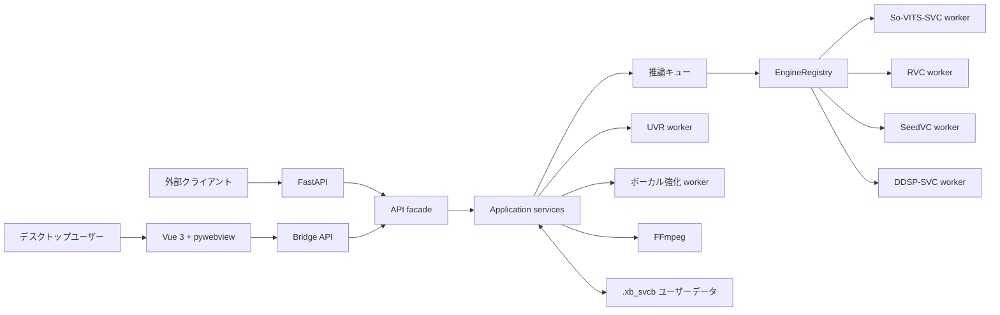

<div align="center">

[简体中文](README.md) | [English](README.en.md) | **日本語**

# XB-SVCB · AIカバー制作ツール

#### すぐに使えるデスクトップ向けAIカバー制作環境

**楽曲読込 · ボーカル分離 · 残響除去 · 歌声変換 · ボーカル強化 · ミックス · 書き出し**

AIカバー制作の全工程を一つのワークフローで実行できます。**So-VITS-SVC / RVC推論**、**複数歌手によるカバー**、**システム音声のリアルタイム変換**、**AIボーカル強化プロジェクト**、**オンライン楽曲ライブラリ**、**モデルハブ**、**オーディオエディター**に対応しています。

[](LICENSE)
[](https://github.com/SDIJF1521/xb-svcb/releases/latest)
[](https://github.com/SDIJF1521/xb-svcb/releases)
[](https://github.com/SDIJF1521/xb-svcb/stargazers)

[](#)
[](#)
[](#)
[](#architecture)

### [ハードウェア別インストーラー: CPU / ROCm 10 / DirectML / CUDA126 / CUDA128](https://github.com/SDIJF1521/xb-svcb/releases/latest)

<sub>Windows向けワンクリックインストール。フロントエンドと基本モデルを同梱し、Python / Node.jsの手動設定は不要です。</sub>

<sub>交流・サポート（QQグループ）: **1038366109**</sub>

<sub>公式サイト: **[https://xb-svcb.cn](https://xb-svcb.cn)** · ドキュメント: **[日本語](docs/ja/README.md)**</sub>
</div>

---

## 概要

XB-SVCBは、Windowsでローカル動作するAIカバー・音声制作アプリケーションです。UIにはVue 3、アプリケーションコアにはPythonを使用し、各AIフレームワークは独立した環境とWorkerプロセスで動作します。

So-VITS-SVC、RVC、SeedVC、DDSP-SVCをサポートしています。また、UVR / PyMSSによるボーカル分離、AIボーカル強化、高音保護、オンライン楽曲ライブラリ、モデルハブ、システム音声のリアルタイム変換、Audio Editor Liteも利用できます。

## 主な機能

- ボーカル分離、残響除去、F0解析、歌声変換、強化、ミックスを一つのワークフローで実行。
- So-VITS-SVC、RVC、SeedVC、DDSP-SVCモデルを統合管理し、フレームワーク別の推論パラメーターを設定。
- モデルの音域を外れた箇所を自動検出し、部分的なピッチ調整と再推論によって高音を保護。
- 歌詞または無音検出で楽曲を分割し、タイムライン上でモデルを割り当てて複数歌手や合唱のカバーを制作。
- Audio Editor Liteでマルチトラック編集、カット、フェード、チャンネル設定、エフェクト処理、WAV / MP3 / FLAC書き出し。
- TXT / LRC歌詞の読み込み、役割管理、ソロ・デュエット・ハーモニー用テンプレート。
- WASAPIループバックまたはVB-CABLEを利用し、伴奏を保ったままプレイヤー音声をリアルタイム変換。
- ModelScopeでのモデル検索、アップロード、ダウンロード、バックグラウンド転送、再開、マニフェスト検証。
- NetEase Cloud Music、QQ Music、Kuwo Musicの楽曲・歌詞を検索、試聴、ダウンロード。
- NVIDIA CUDA、Windows AMD ROCm 10、DirectML、CPUを選択可能。
- 外部プログラム向けに、タスク作成、進捗確認、モデル管理、成果物ダウンロードを行うFastAPIサービスを提供。
- カスタムページ、Python Plugin Worker、C++ JUCE VST3 Hostによる拡張。

## クイックスタート

### インストーラーを使う

通常の利用では、GitHub Releasesの最新版を推奨します。

1. CPU、ROCm 10、DirectML、CUDA126、CUDA128からハードウェアに合うパッケージを選び、EXEと同じ接頭辞を持つすべてのBINファイルをダウンロードします。
2. EXEを実行し、アプリケーションのインストール先とユーザーデータの保存先を選択します。
3. 64ビットCPython 3.12.xを選択するか自動検出を使い、「インストール後に実行環境を構築」を有効にします。
4. デスクトップまたはスタートメニューからXB-SVCBを起動します。

パッケージには、ビルド済みフロントエンド、FFmpeg、各エンジンのソース、主要な基本モデル、選択したハードウェア向けのオフラインPython依存関係が含まれます。NVIDIA RTX 40シリーズ以前はCUDA126、RTX 50シリーズはCUDA128、Windows AMDではROCm 10を優先し、必要に応じてDirectMLを選択してください。対応GPUがない場合はCPUを使用します。DirectMLではPyMSSの高速化は利用できず、DDSPの自動モードはCPUを使用します。

### ソースからインストール

ソースから実行するには、Windows、64ビットCPython 3.12.x、Node.js 20.19+または22.12+が必要です。リポジトリのルートでハードウェアに対応するコマンドを実行します。

```bat
setup_env.bat --cu128
setup_env.bat --cu126
setup_env.bat --rocm10
setup_env.bat --directml
setup_env.bat --cpu
```

CUDA126 / CUDA128では`runtimes/core-*`と`runtimes/svc-*`を共有します。ROCm 10ではSVC、RVC、ボーカル強化のランタイムを共有し、CPU / DirectMLでは分離環境を使用します。詳細な構成とトラブルシューティングは[日本語インストールガイド](docs/ja/getting-started.md)を参照してください。

コンポーネント単位のセットアップ例:

```bat
setup_env.bat --only uvr seedvc ddsp
setup_env.bat --only svc rvc vocal
setup_env.bat --only models
```

CUDA coreのUVR、SeedVC、DDSPは一つの単位として、まとめて修復してください。

### アプリケーションを起動

本番モードでは、ビルド済みの`web/dist`を読み込みます。

```bat
run.bat
```

フロントエンド開発では、一つ目のターミナルでViteを起動します。

```bat
cd web
npm install
npm run dev
```

別のターミナルでPythonバックエンドを起動します。

```bat
app\.venv\Scripts\python.exe app\main.py --dev
```

開発モードは既定で`http://localhost:5173`に接続します。別のURLを使う場合は`XB_DEV_URL`を設定してください。

## 基本ワークフロー

1. 「モデル管理」で音声モデルをインポートまたはダウンロードします。
2. 作成画面で楽曲、ボーカル分離方法、対象モデル、デバイスを選択します。
3. 単一モデルならそのままタスクを開始します。複数モデルの場合は歌詞を読み込むか無音検出でタイムラインを作成します。
4. セグメント境界を調整し、各セグメントに一つ以上のモデルを割り当てます。
5. 推論、強化、ミックスの完了後、ライブラリで試聴または書き出します。
6. 必要に応じてAudio Editor Liteへ送り、範囲指定の再推論、エフェクト、マルチトラック編集を行います。

システム音声のリアルタイムモードでは、RVCまたはSeedVCモデルを一つ使用できます。プレイヤーのミックス音声を取り込み、UVRでボーカルを抽出・変換し、元の伴奏と再ミックスします。

## アーキテクチャ

デスクトップUIとFastAPIは、同じPythonアプリケーションコアを共有します。負荷の高いモデルと音声ツールは、独立したWorkerプロセスで実行されます。



メインプロセスはデスクトップシェル、API、処理の調整のみを担当し、すべてのモデルを一つのPythonプロセスには読み込みません。`runtime.json`が各コンポーネントと実際のインタープリターを対応付けます。

## FastAPI連携

FastAPIは既定で無効です。アプリの「資料庫 → API接入」を開き、バインドアドレス、ポート、API Keyを設定して手動で起動します。

モデル管理、単一・複数モデル推論、バッチ処理、ストリーミングアップロード、進捗・履歴・プリセット、成果物ダウンロード、Audio Editor Liteのプロジェクト操作に対応しています。デスクトップUIとHTTPクライアントは、同じアプリケーションサービスとタスクキューを利用します。[日本語APIガイド](docs/ja/api.md)を参照してください。

## プラグインシステム

プラグインは`PluginService`が管理します。プラグイン画面は制限付きiframeで実行され、Client SDKとBridgeを介してホスト機能を使用します。Pythonおよびハイブリッドプラグインのアクションは独立したWorkerで実行されます。Vue / HTML / JavaScript画面、Python Worker、TypeScript / Python SDKコード、マニフェスト、権限、設定、リソースを含められます。

[日本語プラグインドキュメント](docs/ja/plugins/README.md)から始めてください。別パッケージの[Plugin SDK README](plugin-sdk/README.md)は現在中国語の正式資料です。

## リポジトリ構成

```text
xb-svcb/
├─ app/               Pythonバックエンド、サービス、アダプター、テスト
├─ web/               Vue 3 + Viteフロントエンド
├─ engines/           So-VITS-SVC、SeedVC、DDSP-SVCなどのエンジン
├─ assets/            同梱モデル、ツール、オフラインwheelhouse
├─ install/           環境構築・モデル配置スクリプト
├─ installer/         PyInstaller / Inno Setupパッケージ
├─ native/            JUCE VST3 Host
├─ plugin-sdk/        Plugin SDK
├─ docs/              利用、設計、API、プラグインのドキュメント
├─ run.bat / run.ps1  ソース版の起動エントリ
└─ setup_env.bat      実行環境の構築エントリ
```

## データと設定

既定のユーザーデータディレクトリは`.xb_svcb`です。インポートしたモデル、作品、編集プロジェクト、アップロード、キャッシュ、ログ、設定、プラグイン、プラグインデータ、テーマ素材を保存します。アプリ内で移動するか、`XB_DATA_DIR`で変更できます。通常、インストーラーによる更新では上書きされません。

| 変数 | 用途 |
| --- | --- |
| `XB_DATA_DIR` | ユーザーデータディレクトリを変更。 |
| `XB_DEV` | `1`に設定すると開発モードを有効化。 |
| `XB_DEV_URL` | 開発用フロントエンドURLを変更。 |
| `XB_HF_MIRROR` / `HF_ENDPOINT` | Hugging Faceミラーを指定。 |
| `XB_PYPI_MIRROR` | Pythonパッケージのミラーを指定。 |
| `XB_GH_MIRROR` | GitHubリソースのミラーを指定。 |

## 開発とテスト

リポジトリのルートでバックエンドテストを実行します。

```bat
uv run --project app --with pytest --with scipy==1.13.1 pytest app/tests -q -rs
```

`web`ディレクトリでフロントエンドを検証します。

```bat
npm run type-check
npm run test:unit -- --run
npm run build
```

設計、起動処理、テスト、パッケージ作成、コントリビューター向け資料は[日本語ドキュメント目次](docs/ja/README.md)を参照してください。

## ロードマップ

現在のバージョン: **v0.0.32**

複数フレームワークでの推論、タイムライン式の複数歌手カバー、Audio Editor Lite、ModelScopeモデルハブ、FastAPI連携、CUDA / ROCm 10 / DirectML / CPU対応、プラグインランタイムは実装済みです。今後は歌詞の自動認識とタイムライン生成、モデルメタデータの標準化、プロジェクトの入出力と自動保存、対応フレームワークの追加、動画・歌詞動画の書き出し、Intel GPU / CPU / マルチGPUの最適化に取り組みます。

全バージョンの履歴は[リリースノート](docs/release-notes/)を参照してください。

## コントリビューター

XB-SVCB の開発と保守に参加してくださったすべての皆様に感謝します。

> <a href="https://github.com/SDIJF1521" title="YGXB"></a>&nbsp;&nbsp;<a href="https://github.com/emptyelse" title="emptyelse"></a>&nbsp;&nbsp;&nbsp;&nbsp;

コントリビューター：**YGXB · emptyelse · lizhi · GFMTX**。GitHub アカウントにリンクされたアバターからプロフィールを、[コントリビューター履歴](https://github.com/SDIJF1521/xb-svcb/graphs/contributors)からすべての記録を確認できます。プロジェクトへの参加方法は[コントリビューションガイド](CONTRIBUTING.md)を参照してください。

## 謝辞

- 同梱・デモ用音声モデルの大部分は**白菜工厂1145号员工**氏から提供されました。モデルの著作権は各作者に帰属します。各モデルのライセンスまたは許諾範囲内で使用してください。
- XB-SVCBは、[so-vits-svc](https://github.com/svc-develop-team/so-vits-svc)、[rvc-python](https://github.com/daswer123/rvc-python)、[Seed-VC](https://github.com/Plachtaa/seed-vc)、[DDSP-SVC](https://github.com/yxlllc/DDSP-SVC)、[Ultimate Vocal Remover](https://github.com/Anjok07/ultimatevocalremovergui)、[DeepFilterNet](https://github.com/Rikorose/DeepFilterNet)、[Pedalboard](https://github.com/spotify/pedalboard)、[ModelScope](https://www.modelscope.cn/)などのプロジェクトを利用しています。

## ライセンス

本プロジェクトが独自に作成したソースコードは、**[GNU General Public License v3.0 only](LICENSE)**で提供されます。Copyright © 2026 SDIJF1521。

同梱するサードパーティ製コンポーネント、モデル、リソースには、それぞれ元のライセンスが適用されます。特にso-vits-svc 4.1はAGPL-3.0、DDSP-SVC 6.3はMIT Licenseです。基本モデルとUVRモデルにも各上流プロジェクトの条件が適用され、GPL-3.0-onlyがそれらを置き換えることはありません。
